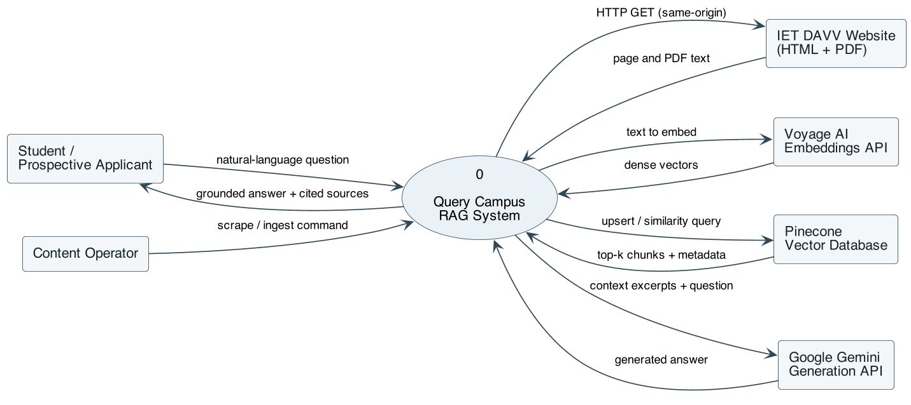
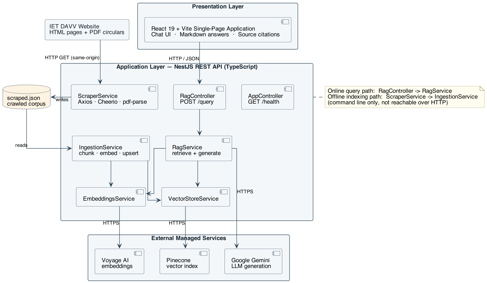
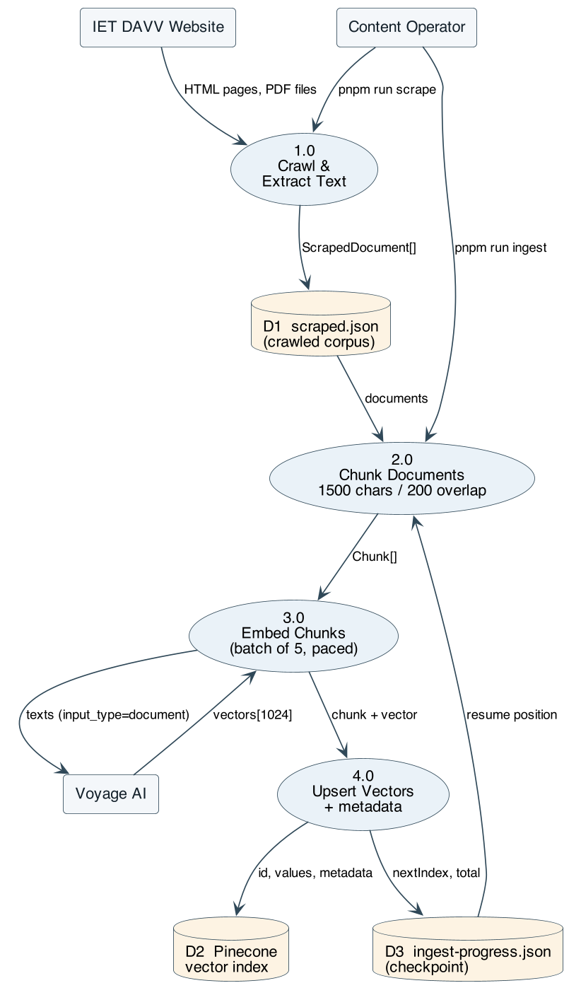
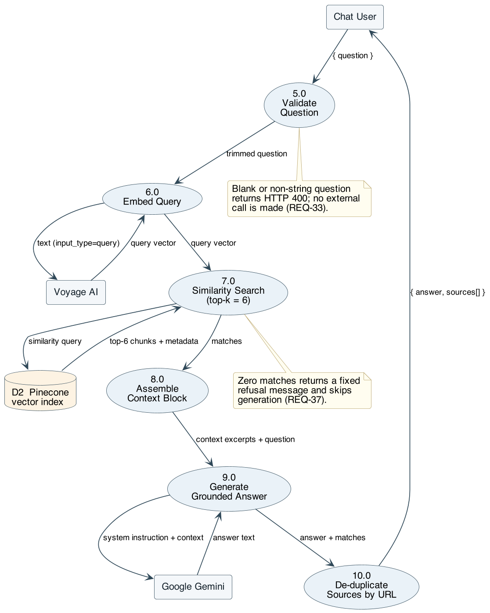
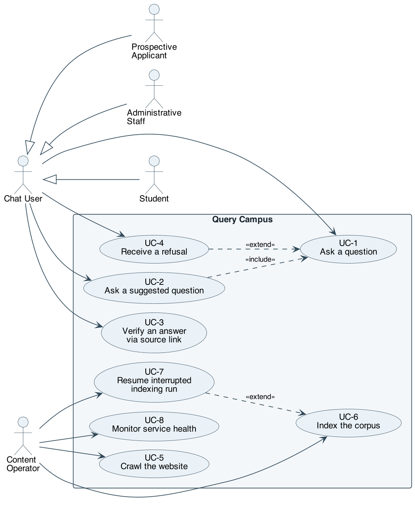
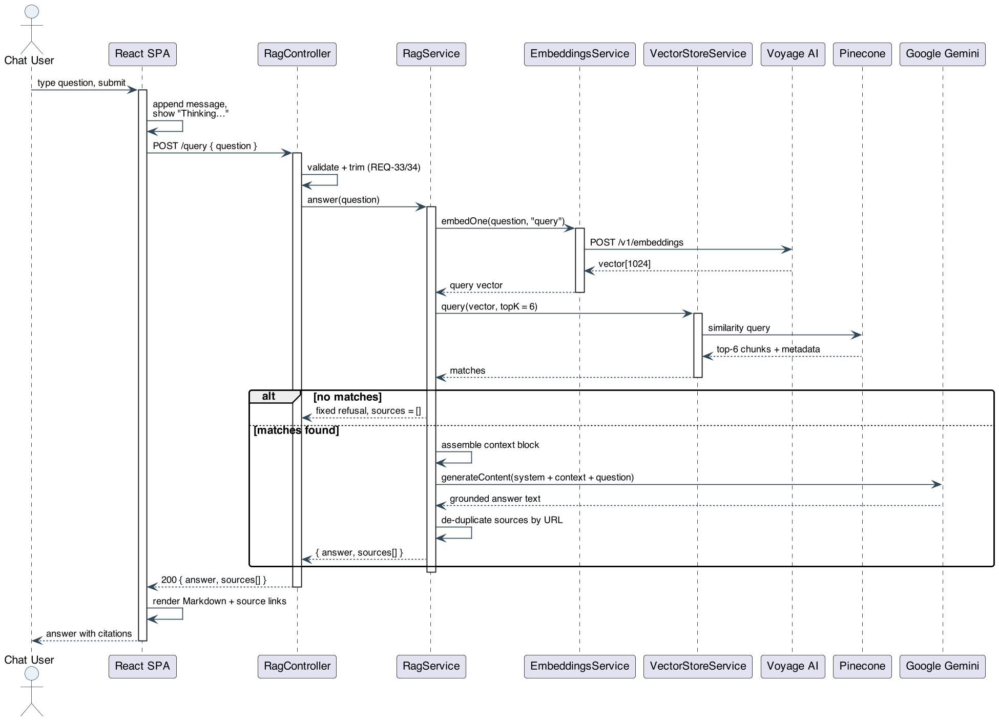
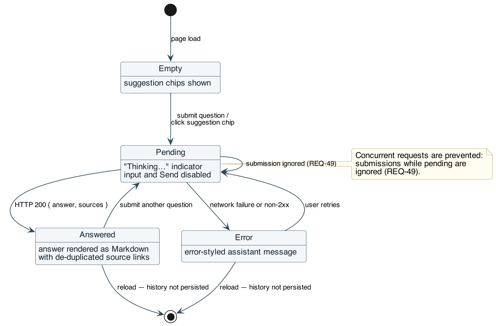
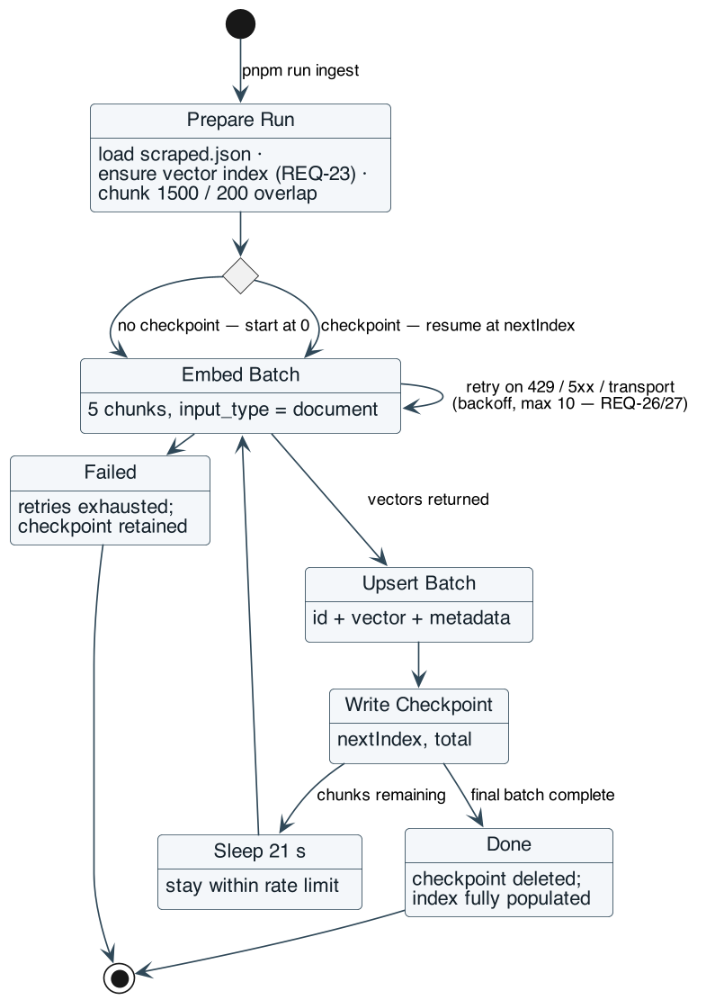
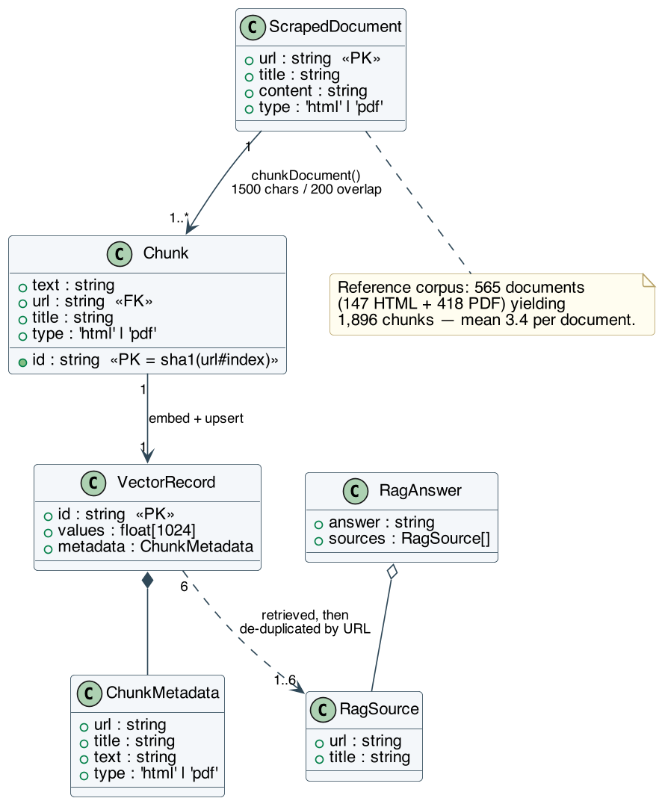

# Software Requirements Specification

## for

# Query Campus

### A Retrieval-Augmented Generation Based Conversational Assistant for College Website Information Access

**Version 1.0 approved**

**Prepared by:** Akshat Sharma (23bit005), Tanmay Choudhary (23bcs072), Riya Rawat (23bit060)

**Supervisor:** Vedpriya Dongre, Department of Computer Engineering

**Organization:** Institute of Engineering and Technology, DAVV, Indore

**Date created:** 20 September 2026

---

## Table of Contents

- [Revision History](#revision-history)
- [1. Introduction](#1-introduction)
  - [1.1 Purpose](#11-purpose)
  - [1.2 Document Conventions](#12-document-conventions)
  - [1.3 Intended Audience and Reading Suggestions](#13-intended-audience-and-reading-suggestions)
  - [1.4 Product Scope](#14-product-scope)
  - [1.5 References](#15-references)
- [2. Overall Description](#2-overall-description)
  - [2.1 Product Perspective](#21-product-perspective)
  - [2.2 Product Functions](#22-product-functions)
  - [2.3 User Classes and Characteristics](#23-user-classes-and-characteristics)
  - [2.4 Operating Environment](#24-operating-environment)
  - [2.5 Design and Implementation Constraints](#25-design-and-implementation-constraints)
  - [2.6 User Documentation](#26-user-documentation)
  - [2.7 Assumptions and Dependencies](#27-assumptions-and-dependencies)
- [3. External Interface Requirements](#3-external-interface-requirements)
  - [3.1 User Interfaces](#31-user-interfaces)
  - [3.2 Hardware Interfaces](#32-hardware-interfaces)
  - [3.3 Software Interfaces](#33-software-interfaces)
  - [3.4 Communications Interfaces](#34-communications-interfaces)
- [4. System Features](#4-system-features)
  - [4.1 Website Crawling and Content Extraction](#41-website-crawling-and-content-extraction)
  - [4.2 Document Chunking and Semantic Indexing](#42-document-chunking-and-semantic-indexing)
  - [4.3 Grounded Question Answering (RAG Query)](#43-grounded-question-answering-rag-query)
  - [4.4 Conversational Chat Interface](#44-conversational-chat-interface)
  - [4.5 Source Citation and Traceability](#45-source-citation-and-traceability)
  - [4.6 Service Health and Operability](#46-service-health-and-operability)
- [5. Other Nonfunctional Requirements](#5-other-nonfunctional-requirements)
  - [5.1 Performance Requirements](#51-performance-requirements)
  - [5.2 Safety Requirements](#52-safety-requirements)
  - [5.3 Security Requirements](#53-security-requirements)
  - [5.4 Software Quality Attributes](#54-software-quality-attributes)
  - [5.5 Business Rules](#55-business-rules)
- [6. Other Requirements](#6-other-requirements)
- [Appendix A: Glossary](#appendix-a-glossary)
- [Appendix B: Analysis Models](#appendix-b-analysis-models)
- [Appendix C: To Be Determined List](#appendix-c-to-be-determined-list)

---

## Revision History

| Name | Date | Reason For Changes | Version |
|------|------|--------------------|---------|
| Akshat Sharma, Tanmay Choudhary, Riya Rawat | 20 Sep 2026 | Initial SRS derived from the approved project synopsis and the implemented prototype codebase | 1.0 |

---

# 1. Introduction

## 1.1 Purpose

This Software Requirements Specification (SRS) defines the functional and nonfunctional requirements for **Query Campus, Release 1.0** — a Retrieval-Augmented Generation (RAG) based conversational assistant that answers natural-language questions about the Institute of Engineering and Technology, DAVV (IET DAVV) using content published on the institute's own website.

This document covers the complete system as currently scoped, comprising three cooperating subsystems within a single TypeScript monorepo:

1. The **offline indexing pipeline** — a same-origin web crawler, a PDF/HTML text extractor, a text chunker, an embedding client, and a vector-store loader.
2. The **online query service** — a REST backend that embeds a user question, retrieves semantically similar content, and generates a grounded answer.
3. The **web client** — a single-page chat application through which end users ask questions and read cited answers.

Administrative dashboards, user accounts, multi-institution tenancy, and conversational memory across turns are explicitly **out of scope** for Release 1.0 and are listed in Section 6.

## 1.2 Document Conventions

- The document follows the IEEE-derived SRS template by Karl E. Wiegers (1999).
- Every functional requirement carries a unique identifier of the form **REQ-n**, numbered sequentially within its parent feature in Section 4. Nonfunctional requirements carry the prefixes **PERF-n**, **SAFE-n**, **SEC-n**, **QUAL-n**, and **BR-n**.
- The key words **shall** (mandatory), **should** (recommended), and **may** (optional) are used in their conventional requirements-engineering sense. A statement using **shall** is binding on Release 1.0.
- Each feature in Section 4 is assigned a priority of **High**, **Medium**, or **Low**. Priorities are **not** inherited: a High-priority feature may contain Medium-priority individual requirements, and each requirement's priority is the priority of its parent feature unless stated otherwise on the requirement itself.
- Fixed literal values (e.g. `1500`, `topK = 6`) reflect the configuration of the implemented prototype and are stated as defaults; requirements mark explicitly where a value shall be configurable.
- Monospaced text denotes file paths, identifiers, environment variables, HTTP routes, or JSON fields.

## 1.3 Intended Audience and Reading Suggestions

| Reader | Purpose | Suggested reading order |
|--------|---------|-------------------------|
| Project supervisor / evaluators | Verify that the delivered system matches the approved synopsis and assess completeness | §1.4, §2, §4, §5, Appendix B |
| Developers (project team) | Implement, extend, and maintain the system | §2.5, §3, §4, §5, Appendix A |
| Testers | Derive test cases and acceptance criteria | §4 (stimulus/response and REQ items), §5.1, §5.3 |
| Maintainers / future teams re-pointing the system at another institution | Understand configuration surface and reuse boundaries | §2.4, §2.5, §2.7, §3.3, §6 |
| End users (students, applicants, staff) | Understand what the assistant can and cannot answer | §1.4, §2.2, §2.3, §5.5 |

All readers should begin with Section 1.4 (Product Scope) and Section 2 (Overall Description). Readers concerned with behaviour should then read Section 4 in full; readers concerned with quality, limits, and operating rules should read Section 5. Appendix A defines the RAG-specific terminology used throughout.

## 1.4 Product Scope

Query Campus is a self-hosted conversational search layer over the IET DAVV website. Essential information for students — admission procedures, fee structures, exam schedules, scholarship forms, notices, and academic calendars — is distributed across roughly 150 HTML pages and over 400 linked PDF circulars with no unified way to ask a direct question and receive an accurate answer. Students currently browse manually or repeatedly contact administrative staff; generic LLM assistants, asked the same questions, hallucinate institution-specific facts with high confidence.

Query Campus addresses this by crawling the institute's published content, indexing it as dense vector embeddings, and answering questions **strictly from the retrieved content**, with the source pages cited and an explicit refusal when the answer is not present in the index.

The principal benefits and objectives are:

- **Reduced time-to-answer** relative to manual browsing of the college website.
- **Hallucination resistance** — the assistant declines rather than fabricates when the indexed corpus does not contain the answer.
- **Verifiability** — every answer is accompanied by links to the source pages it was drawn from.
- **Self-updating knowledge** — re-running the scrape-and-ingest pipeline refreshes the index without any change to retrieval or generation logic.
- **Reusability** — because the pipeline is website-agnostic and driven by a base-URL configuration value, the same architecture can be re-pointed at another institution's website with minimal reconfiguration.

## 1.5 References

1. Perplexity AI, "Perplexity – AI-Powered Conversational Search Engine," Perplexity AI, Inc., 2024. https://www.perplexity.ai
2. ChatPDF, "ChatPDF – Chat with Any PDF Using AI," 2024. https://www.chatpdf.com
3. Ivy.ai, "Ivy.ai – Generative AI Chatbots for Higher Education," Ivy.ai Inc., 2024. https://ivy.ai/higher-education
4. Ocelot, "Chatbot – AI Chatbot for Higher Education Student Engagement," 2024. https://ocelotbot.com/features/chatbot
5. Element451, "BoltBot – Intelligent AI Chatbot for Higher Education," Element451 Inc., 2024. https://element451.com/boltbot-intelligent-chatbot
6. Gravyty, "AI Chatbot for Higher Education – Ivy & Ocelot," 2024. https://gravyty.com/products/ai-chatbot-for-higher-education
7. Pinecone Systems Inc., "Pinecone Vector Database – Documentation," 2024. https://docs.pinecone.io
8. Voyage AI, "Voyage AI – Embedding Models Documentation," 2024. https://docs.voyageai.com
9. Google, "Gemini API – Developer Documentation," Google AI for Developers, 2024. https://ai.google.dev/gemini-api/docs
10. NestJS, "NestJS – A Progressive Node.js Framework – Documentation," OpenJS Foundation, 2024. https://docs.nestjs.com
11. React, "React – The Library for Web and Native User Interfaces," Meta Open Source, 2024. https://react.dev
12. Axios, "Axios – Promise Based HTTP Client for the Browser and Node.js," 2024. https://axios-http.com/docs
13. K. E. Wiegers, "Software Requirements Specification Template," 1999. *(Structural basis for this document.)*
14. Query Campus Project Synopsis, IET DAVV, September 2026. *(Vision and scope source for this SRS.)*
15. Query Campus repository `README.md` — setup, scrape/ingest, and run instructions.

---

# 2. Overall Description

## 2.1 Product Perspective

Query Campus is a **new, self-contained product**, not a replacement for or a follow-on member of an existing product family. It does not modify the IET DAVV website; it sits alongside it as a read-only consumer of its published content.

Figure 1 places the product in its environment: two classes of human user, the institutional website it draws its knowledge from, and the three managed services it depends on. Figure 2 opens the system up, showing the three-layer internal structure — with all persistent knowledge held in the external vector database rather than in any store the product owns.





Two distinct execution paths exist:

- The **offline indexing path** (`pnpm run scrape`, `pnpm run ingest`) is operator-triggered, runs as a command-line Nest application context, and writes to the vector store. It is not reachable over HTTP.
- The **online query path** (`POST /query`) is user-triggered, stateless, and only reads from the vector store.

## 2.2 Product Functions

At a high level, Query Campus must:

- **Crawl** the configured institutional website, restricted to the same origin, collecting HTML pages and linked PDF documents up to a configurable page limit.
- **Extract** readable text from HTML (discarding navigation, headers, footers, scripts, and styling) and from PDF circulars and forms.
- **Persist** the crawled corpus as a structured JSON dataset so that indexing can be repeated without re-crawling.
- **Chunk** each document into overlapping fixed-size text segments so that local context is preserved across chunk boundaries.
- **Embed** each chunk into a dense vector using a hosted embedding model, and **upsert** it into a vector index together with citation metadata (source URL, page title, document type, chunk text).
- **Resume** a partially completed ingestion run from its last checkpoint rather than restarting from the beginning.
- **Accept** a natural-language question from a user over a REST endpoint.
- **Retrieve** the top-*k* most semantically similar chunks for that question via approximate nearest-neighbour search.
- **Generate** a concise answer with an LLM constrained to use only the retrieved context, and **decline** explicitly when the context does not contain the answer.
- **Return and display** the answer as formatted Markdown alongside a de-duplicated list of clickable source links.
- **Report** service health for monitoring and deployment checks.

## 2.3 User Classes and Characteristics

| User class | Description | Frequency of use | Technical expertise | Importance |
|-----------|-------------|------------------|---------------------|------------|
| **Current students** | Ask about exam timetables, fee deadlines, scholarship procedures, grievance channels, and notices. The primary class the product is optimised for. | Daily to weekly, in bursts around deadlines | Low; expects a chat box and nothing more | **Most important** |
| **Prospective applicants** | Ask about admission criteria, required documents, programs offered, and fee structures. Often unfamiliar with the website's layout, so they benefit most from natural-language access. | Seasonal, concentrated in the admission window | Low | **Most important** |
| **Administrative staff** | Use the assistant to answer repetitive informational queries quickly, and to check what the site currently states on a topic. | Occasional | Low to moderate | Important |
| **Content/knowledge-base operator** | A team member or administrator who re-runs the scrape-and-ingest pipeline after the website changes, and who holds the API credentials. Interacts through the command line, not the chat UI. | Periodic (after site updates) | High; comfortable with Node.js, `pnpm`, and environment files | Important — the only class with privileged functions |
| **Developers / maintainers** | Extend the system or re-point it at another institution. | Continuous during development | High | Supporting |

All chat-facing classes (students, applicants, staff) share an identical, unauthenticated feature set; Release 1.0 draws no privilege distinction between them. Only the operator class has access to the indexing functions, and that access is filesystem- and credential-based rather than enforced by the application.

## 2.4 Operating Environment

- **OE-1:** The backend shall run on Node.js (LTS, ES-module mode) on any operating system supporting it — Linux, macOS, or Windows. No specialised hardware, GPU, or local database server is required.
- **OE-2:** The backend shall listen on a configurable TCP port, defaulting to `3001`.
- **OE-3:** The web client shall be delivered as a static single-page bundle built by Vite, served either by the Vite dev server (default port `5173`) or by any static web server or CDN in production.
- **OE-4:** The client shall run in current versions of evergreen desktop and mobile browsers (Chrome, Edge, Firefox, Safari) with JavaScript enabled, at viewport widths from 360 px upward.
- **OE-5:** The host running the backend and the indexing scripts shall have outbound HTTPS access to `api.voyageai.com`, the Pinecone control and data planes, `generativelanguage.googleapis.com`, and the target institutional website.
- **OE-6:** The repository shall be managed as a `pnpm` workspace monorepo (`apps/frontend`, `apps/backend`) and shall build with TypeScript.
- **OE-7:** The system shall coexist with the live institutional website without requiring any modification, plugin, or cooperation from it beyond ordinary public HTTP access.

## 2.5 Design and Implementation Constraints

- **CON-1: Grounding constraint.** The generation step shall be prompted to answer using only the supplied retrieved context, and shall be instructed not to invent URLs, dates, or numbers absent from that context. Answer quality is therefore bounded by scrape coverage and chunking granularity; this is an accepted trade-off of the design.
- **CON-2: Same-origin crawling.** The crawler shall follow only links whose hostname, after stripping a leading `www.`, equals the hostname of the configured base URL. External domains shall never be fetched or indexed.
- **CON-3: Polite crawling.** The crawler shall identify itself with a descriptive `User-Agent` string, shall bound concurrency (default 4 simultaneous requests), and shall enforce request timeouts (15 s for HTML, 20 s for PDF) and response-size caps (10 MB for HTML, 20 MB for PDF).
- **CON-4: Third-party API rate limits.** The embedding provider's free tier is restricted (approximately 3 requests/minute and 10K tokens/minute without a payment method on file). Ingestion shall therefore use small batches (default 5 chunks) paced by a fixed inter-batch delay (default 21 s), with exponential-style backoff and honouring of `Retry-After` headers on failure. This dominates ingestion wall-clock time and is a known constraint, not a defect.
- **CON-5: Embedding dimensionality coupling.** The vector index dimension shall match the embedding model's output dimension (default 1024). Changing the embedding model requires recreating the index and re-ingesting the entire corpus.
- **CON-6: Technology stack.** The implementation shall use NestJS (backend), React 19 + Vite + Tailwind CSS (frontend), Axios + Cheerio (crawling), `pdf-parse` (PDF text extraction), Voyage AI (embeddings), Pinecone (vector store), and Google Gemini (generation), as justified in the project synopsis.
- **CON-7: Language and typing.** All application code shall be written in TypeScript with strict typing; linting shall be enforced with `oxlint` and formatting with Prettier.
- **CON-8: Credential handling.** All third-party API keys shall be supplied through environment variables loaded from an untracked `.env` file, and shall never be committed to version control or exposed to the web client.
- **CON-9: Statelessness.** The query endpoint shall be stateless: no conversation history, user identity, or session is stored server-side. Chat history exists only in the browser tab's memory for the lifetime of the page.
- **CON-10: Testing toolchain.** Unit and end-to-end tests shall be written with Vitest and Supertest to remain consistent with the TypeScript/Vite toolchain.

## 2.6 User Documentation

The following documentation components shall be delivered with the software:

- **DOC-1:** A repository `README.md` covering prerequisites, dependency installation, backend and frontend environment configuration, how to obtain each of the three API keys, how to run the scrape and ingest commands, how to start both applications in development, and a plain-language description of how the pipeline works.
- **DOC-2:** An annotated `.env.example` file for each application enumerating every configuration variable with its default value and, where applicable, the URL at which the corresponding credential is issued.
- **DOC-3:** In-application guidance in the chat UI: a short subtitle stating what the assistant covers, and a set of example questions presented as clickable suggestion chips on the empty state.
- **DOC-4:** This SRS and the approved project synopsis, delivered as project documentation.

All documentation is delivered in Markdown within the repository, except the synopsis and SRS submission copies, which may additionally be provided as formatted documents.

## 2.7 Assumptions and Dependencies

**Assumptions**

- **AS-1:** The institutional website remains publicly accessible over HTTP without authentication, and its informational content is present in server-rendered HTML rather than requiring client-side JavaScript execution to appear.
- **AS-2:** The site's main content region is identifiable by a stable container selector (`#sp-component` in the current template); content outside it is chrome and may be discarded.
- **AS-3:** Published PDFs contain an extractable text layer. Scanned, image-only PDFs will yield no text and will be skipped; OCR is not performed.
- **AS-4:** The content published on the website is itself accurate and current. Query Campus faithfully reports what the site says; it cannot detect that the site is out of date.
- **AS-5:** A corpus on the order of 550–600 documents and roughly 2.2 million characters (approximately 1,900 chunks) is representative of the target site's size.
- **AS-6:** Users pose questions in English.
- **AS-7:** The operator re-runs the indexing pipeline periodically; the index's freshness is a function of that cadence, which is an operational rather than a software matter.

**Dependencies**

- **DP-1:** Voyage AI embeddings API — availability, pricing, rate limits, and the continued availability of the configured model and its vector dimension.
- **DP-2:** Pinecone serverless vector database — availability of the configured index and region.
- **DP-3:** Google Gemini generative API — availability of the configured model and its context window.
- **DP-4:** The structure of the target website's HTML template. A redesign that changes the main content container will degrade extraction quality until the selector is updated.
- **DP-5:** Open-source libraries listed in Section 3.3, at the major versions pinned in the workspace manifests.
- **DP-6:** Network egress from the deployment host to all of the above.

If any of DP-1 through DP-3 is unavailable, the affected path fails: indexing cannot proceed without DP-1 or DP-2, and answering fails without DP-1, DP-2, or DP-3.

---

# 3. External Interface Requirements

## 3.1 User Interfaces

The sole graphical interface is a single-page chat application. It is deliberately minimal: there are no menus, no settings screens, and no navigation.

**Screen layout (top to bottom):**

1. **Header** — the product name "Query Campus" and a one-line subtitle stating the assistant's scope.
2. **Message list** — a vertically scrolling, centred column (maximum width ≈ 42 rem) containing the conversation.
   - **Empty state:** the prompt "Try asking:" followed by four clickable suggestion chips covering representative tasks (admission documents, scholarship application, grievance submission, exam timetable). Clicking a chip submits that question immediately.
   - **User messages:** right-aligned, rendered as plain text in a high-contrast bubble.
   - **Assistant messages:** left-aligned, rendered as Markdown (paragraphs, bullet lists, emphasis) so that lists of dates, fees, and required documents are legible.
   - **Source block:** where sources exist, a separated footer inside the assistant bubble labelled "Sources", listing each source as a truncated hyperlink opening in a new tab.
   - **Error messages:** left-aligned in a visually distinct (red) bubble.
   - **Pending indicator:** while a request is in flight, a placeholder bubble reading "Thinking…".
3. **Composer** — a fixed bottom bar containing a single-line text input with placeholder text and a **Send** button.

**Interface requirements:**

- **UI-1:** The input shall accept free-form text; submitting the form (Enter key or Send button) shall dispatch the question.
- **UI-2:** The Send button shall be disabled while a request is in flight or while the input is empty or whitespace-only.
- **UI-3:** After each response or error, the message list shall scroll smoothly to the newest message.
- **UI-4:** The interface shall support light and dark colour schemes, following the operating system preference.
- **UI-5:** The layout shall be responsive, using dynamic viewport height so that the composer remains reachable on mobile browsers with dynamic toolbars.
- **UI-6:** All error conditions shall be surfaced as an assistant-side message in the conversation; the interface shall never present a raw stack trace, HTTP status code, or provider error payload to the user.
- **UI-7:** Detailed visual design (spacing, typography scale, exact colours) is delegated to the implementation's Tailwind CSS utility classes and is not further constrained by this specification.

## 3.2 Hardware Interfaces

Query Campus has **no direct hardware interfaces**. It is a pure software system that interacts with hardware only through standard operating-system and browser abstractions.

- **HW-1:** The backend shall run on any general-purpose machine (physical, virtual, or container) capable of running Node.js; no GPU, accelerator, or specialised peripheral is required, since all embedding and generation compute is performed by remote managed APIs.
- **HW-2:** The backend requires local disk for the crawled corpus (`apps/backend/data/scraped.json`, on the order of a few megabytes) and the ingestion checkpoint file.
- **HW-3:** The client requires a display, a pointing device or touchscreen, and a keyboard or on-screen keyboard, all accessed through the browser's standard input/output abstractions.
- **HW-4:** Network hardware is accessed exclusively through the operating system's TCP/IP stack; no device-level protocols are used.

## 3.3 Software Interfaces

### 3.3.1 Internal component interfaces

| Component | Provides | Consumes |
|-----------|----------|----------|
| `ScraperService` | `crawl(): ScrapedDocument[]` | Configuration; target website over HTTP |
| `chunkDocument()` | `Chunk[]` from a `ScrapedDocument` | — |
| `EmbeddingsService` | `embed(texts, inputType)`, `embedOne(text, inputType)` | Voyage AI API |
| `VectorStoreService` | `ensureIndex()`, `upsert(records)`, `query(vector, topK)` | Pinecone API |
| `IngestionService` | `ingest(documents, options)` | `EmbeddingsService`, `VectorStoreService` |
| `RagService` | `answer(question): { answer, sources }` | `EmbeddingsService`, `VectorStoreService`, Gemini API |
| `RagController` | `POST /query` | `RagService` |
| `AppController` | `GET /health` | — |

Shared data contracts:

```ts
interface ScrapedDocument { url: string; title: string; content: string; type: 'html' | 'pdf' }
interface Chunk          { id: string; text: string; url: string; title: string; type: 'html' | 'pdf' }
interface ChunkMetadata  { url: string; title: string; text: string; type: 'html' | 'pdf' }
interface RagSource      { url: string; title: string }
interface RagAnswer      { answer: string; sources: RagSource[] }
```

### 3.3.2 External service interfaces

- **SI-1 — Voyage AI Embeddings.** `POST https://api.voyageai.com/v1/embeddings`, bearer-token authenticated, JSON request `{ input: string[], model, input_type }` where `input_type` is `"document"` during ingestion and `"query"` at question time. The response's embedding array shall be re-sorted by the returned `index` field before use. Request timeout: 30 s. Default model `voyage-3`, dimension 1024.
- **SI-2 — Pinecone Vector Database.** Accessed through the official `@pinecone-database/pinecone` client, API-key authenticated. Operations used: list indexes, create index (serverless, AWS `us-east-1`, cosine metric, dimension from configuration, wait-until-ready), upsert records, and similarity query with metadata included. Index name is configurable, defaulting to `query-campus`.
- **SI-3 — Google Gemini.** `POST https://generativelanguage.googleapis.com/v1beta/models/{model}:generateContent`, authenticated by the `x-goog-api-key` header. The request carries a system instruction encoding the grounding rules and a single user turn containing the assembled context excerpts followed by the question, with `maxOutputTokens: 2048`. Request timeout: 60 s. Default model `gemini-3.6-flash`.
- **SI-4 — Target website.** Ordinary HTTP GET requests for HTML and PDF resources; no API contract exists, and the system shall tolerate arbitrary markup, non-HTML content types, and fetch failures.

### 3.3.3 Library dependencies

Backend: `@nestjs/common`, `@nestjs/core`, `@nestjs/config`, `@nestjs/platform-express`, `axios`, `cheerio`, `p-limit`, `pdf-parse`, `@pinecone-database/pinecone`, `reflect-metadata`, `rxjs`. Testing: `vitest`, `supertest`, `@nestjs/testing`.

Frontend: `react`, `react-dom`, `react-markdown`; build and styling via `vite`, `@vitejs/plugin-react`, `tailwindcss`, `@tailwindcss/vite`, `@tailwindcss/typography`.

## 3.4 Communications Interfaces

- **CI-1:** The client shall communicate with the backend over HTTP/1.1 using JSON request and response bodies with `Content-Type: application/json`, using the browser Fetch API. The backend base URL shall be supplied to the client at build time through the `VITE_API_URL` environment variable, defaulting to `http://localhost:3001`.
- **CI-2:** The backend shall expose the following HTTP interface:

  | Method | Path | Request body | Success response | Error responses |
  |--------|------|--------------|------------------|-----------------|
  | `POST` | `/query` | `{ "question": "<non-empty string>" }` | `200` with `{ "answer": string, "sources": [{ "url": string, "title": string }] }` | `400` when `question` is missing, not a string, or blank; `500` on unrecoverable upstream failure |
  | `GET` | `/health` | — | `200` with `{ "status": "ok" }` | — |

- **CI-3:** The backend shall enable Cross-Origin Resource Sharing so that the separately-origin web client can call it. For development this reflects the requesting origin; see SEC-4 for the production requirement.
- **CI-4:** All communication with third-party services (Voyage AI, Pinecone, Gemini) shall use HTTPS with TLS, and all credentials shall be transmitted in request headers, never in URL query strings.
- **CI-5:** Communication with the target website may use HTTP or HTTPS as the site's own links dictate, and is read-only (GET requests only).
- **CI-6:** No email, push notification, WebSocket, or server-sent-event channel is required in Release 1.0. Answers are delivered as a single complete response rather than streamed.

---

# 4. System Features

This section organises the functional requirements by system feature. Features 4.1 and 4.2 belong to the offline indexing pipeline; features 4.3 through 4.6 belong to the online serving path.

## 4.1 Website Crawling and Content Extraction

### 4.1.1 Description and Priority

Automated traversal of the configured institutional website to collect readable text from HTML pages and linked PDF documents, persisted as a structured corpus file. This feature supplies the raw material for every answer the system can give; without it there is no knowledge base.

**Priority: High.** (Benefit: 9 · Penalty: 9 · Cost: 5 · Risk: 6 — the risk is concentrated in the site's markup structure and PDF text quality, both outside the team's control.)

### 4.1.2 Stimulus/Response Sequences

| # | Stimulus | Response |
|---|----------|----------|
| 1 | Operator runs `pnpm run scrape` | System logs the base URL, seeds the frontier with it, and begins breadth-first traversal |
| 2 | An HTML page is fetched successfully | System extracts same-site links, strips chrome, extracts main-region text, and records a document |
| 3 | A URL ending in `.pdf` is dequeued | System downloads the file, extracts its text layer, and records a document of type `pdf` |
| 4 | A fetch fails, times out, or returns a non-HTML content type | System logs a warning and continues with the remaining frontier; the run does not abort |
| 5 | The page limit is reached, or the frontier empties | System writes the corpus to `apps/backend/data/scraped.json` and reports the document count |

### 4.1.3 Functional Requirements

- **REQ-1:** The system shall accept a configurable crawl base URL (`SCRAPE_BASE_URL`) and a configurable maximum page count (`SCRAPE_MAX_PAGES`, default 600), and shall stop traversal once the number of visited URLs reaches that maximum.
- **REQ-2:** The system shall perform a breadth-first traversal beginning at the base URL, maintaining a visited set and a pending frontier, and shall never fetch the same normalised URL twice within a run.
- **REQ-3:** The system shall normalise every URL before comparison and storage by removing the fragment identifier and stripping a trailing slash from non-root paths.
- **REQ-4:** The system shall enqueue only links whose hostname, after removal of a leading `www.`, equals the base URL's hostname so normalised. Links to any other host shall be discarded.
- **REQ-5:** The system shall discard `mailto:`, `tel:`, and `javascript:` links, and links whose path ends in a non-document extension (images, stylesheets, scripts, fonts, archives, audio, and video).
- **REQ-6:** The system shall resolve relative hyperlinks against the URL of the page on which they appear, and shall silently ignore links that cannot be parsed as URLs.
- **REQ-7:** The system shall issue requests with a descriptive `User-Agent` identifying the crawler as an educational project, and shall limit in-flight requests to a fixed concurrency (default 4).
- **REQ-8:** The system shall apply a 15-second timeout and a 10 MB response-size limit to HTML requests, and a 20-second timeout and a 20 MB size limit to PDF requests.
- **REQ-9:** The system shall process a response as an HTML page only if its `Content-Type` header indicates `text/html`; other content types shall be skipped without error.
- **REQ-10:** Before text extraction the system shall remove non-content elements from the parsed document, including `script`, `style`, `nav`, `footer`, `noscript`, and the site template's header, menu, footer, off-canvas menu, and search containers.
- **REQ-11:** The system shall extract page text preferentially from the site's main content container (`#sp-component`), falling back to the document body when that container is absent, and shall collapse all runs of whitespace into single spaces.
- **REQ-12:** The system shall record each HTML page's title from its `<title>` element, falling back to the page URL when no title is present.
- **REQ-13:** For URLs ending in `.pdf`, the system shall download the file as binary, extract its text layer, collapse whitespace, and record the document with its filename as the title and type `pdf`. PDFs shall not be traversed for links.
- **REQ-14:** The system shall discard any extracted document whose cleaned text is shorter than 50 characters, on the basis that it carries no usable information.
- **REQ-15:** The system shall handle any fetch, parse, or extraction failure for an individual URL by logging a warning and continuing; a single failing URL shall never terminate the crawl.
- **REQ-16:** The system shall emit progress logs during the crawl reporting the number of pages visited, documents collected, and URLs queued.
- **REQ-17:** On completion the system shall serialise the collected documents as formatted JSON to `apps/backend/data/scraped.json`, each entry carrying `url`, `title`, `content`, and `type`, and shall report the number of documents written.

## 4.2 Document Chunking and Semantic Indexing

### 4.2.1 Description and Priority

Transformation of the crawled corpus into a searchable semantic index: splitting documents into overlapping chunks, embedding each chunk as a dense vector, and upserting it into the vector database with the metadata needed for later citation. Ingestion must survive rate limiting and interruption.

**Priority: High.** (Benefit: 9 · Penalty: 9 · Cost: 6 · Risk: 7 — the risk is dominated by third-party rate limits, which the checkpointing and backoff requirements exist to absorb.)

### 4.2.2 Stimulus/Response Sequences

| # | Stimulus | Response |
|---|----------|----------|
| 1 | Operator runs `pnpm run ingest` | System loads the corpus, verifies the vector index exists (creating it if not), chunks all documents, and reports the chunk count |
| 2 | A checkpoint file is present from a previous run | System reports the resume position and begins from that chunk index |
| 3 | A batch of chunks is ready | System requests embeddings, upserts the resulting vectors with metadata, logs progress, writes a checkpoint, and pauses before the next batch |
| 4 | The embedding API returns HTTP 429 or a 5xx error | System waits — honouring `Retry-After` when supplied, otherwise using an increasing backoff delay — and retries up to the retry limit |
| 5 | The final batch completes | System deletes the checkpoint file and reports completion |

### 4.2.3 Functional Requirements

- **REQ-18:** The system shall read the crawled corpus from `apps/backend/data/scraped.json` and reject the run if the file is absent or unparsable.
- **REQ-19:** The system shall split each document's text into sequential chunks of at most 1,500 characters, with each chunk after the first overlapping the previous one by 200 characters, so that context spanning a boundary is preserved in at least one chunk.
- **REQ-20:** The system shall trim each chunk and discard any chunk that is empty after trimming.
- **REQ-21:** The system shall assign each chunk a deterministic identifier derived from a SHA-1 hash of its source URL and its ordinal position within that document, so that re-ingesting unchanged content updates existing vectors in place rather than duplicating them.
- **REQ-22:** The system shall carry the source URL, document title, and document type forward from each document onto every chunk derived from it.
- **REQ-23:** Before any upsert, the system shall verify that the configured vector index exists, and shall create it if it does not — as a serverless cosine-similarity index whose dimension equals the configured embedding dimension — waiting until the index is ready before proceeding.
- **REQ-24:** The system shall request embeddings in batches of a fixed size (default 5 chunks) using the `document` input type, and shall pause for a fixed interval (default 21 seconds) between batches to remain within the embedding provider's rate limits.
- **REQ-25:** The system shall upsert each embedded batch into the vector index as records comprising the chunk identifier, the embedding vector, and metadata containing the source URL, title, chunk text, and document type. Upserts shall themselves be sub-batched at no more than 100 records per call.
- **REQ-26:** The system shall retry a failed embedding request when the failure is a rate-limit response (HTTP 429), a server error (HTTP 5xx), or a transport-level failure with no response, up to a maximum of 10 attempts; it shall not retry other client errors.
- **REQ-27:** When retrying, the system shall wait for the interval given by the response's `Retry-After` header when present, and otherwise for an increasing delay bounded at 90 seconds, logging each retry with the failure reason and attempt number.
- **REQ-28:** The system shall write a checkpoint recording the next un-ingested chunk index and the total chunk count after every successfully upserted batch.
- **REQ-29:** On startup the system shall resume from the recorded checkpoint when one exists, and shall log the resume position.
- **REQ-30:** On successful completion of the final batch the system shall delete the checkpoint file so that the next run starts from the beginning.
- **REQ-31:** The system shall log ingestion progress as the number of chunks upserted against the total.

## 4.3 Grounded Question Answering (RAG Query)

### 4.3.1 Description and Priority

The core service: converting a natural-language question into a concise, source-grounded answer by embedding the question, retrieving the most semantically similar indexed chunks, and generating an answer constrained to that retrieved context.

**Priority: High.** (Benefit: 9 · Penalty: 9 · Cost: 5 · Risk: 6 — the principal risk is answer quality when retrieval misses, mitigated by the explicit-refusal requirement.)

### 4.3.2 Stimulus/Response Sequences

| # | Stimulus | Response |
|---|----------|----------|
| 1 | Client sends a valid question to `POST /query` | System embeds the question, retrieves the top-*k* chunks, generates an answer, and returns it with de-duplicated sources |
| 2 | Client sends a request with a missing, non-string, or blank question | System returns HTTP 400 with an explanatory message and performs no embedding, retrieval, or generation |
| 3 | Retrieval returns no matches | System returns a fixed message stating that nothing relevant was found and suggesting rephrasing or consulting the official site, with an empty sources list, and does not call the LLM |
| 4 | Retrieved context does not contain the answer | The LLM, per its system instruction, states that it does not have the information and suggests checking the official website or contacting the college |
| 5 | The generation API returns a transient error | System retries with backoff; if retries are exhausted, the request fails and the client renders an error message |

### 4.3.3 Functional Requirements

- **REQ-32:** The system shall expose a `POST /query` endpoint accepting a JSON body containing a `question` field.
- **REQ-33:** The system shall reject with HTTP 400 and the message `question is required` any request whose body is absent, whose `question` field is missing, whose `question` is not a string, or whose `question` contains only whitespace.
- **REQ-34:** The system shall trim leading and trailing whitespace from the question before processing it.
- **REQ-35:** The system shall embed the question using the same embedding model used at ingestion time, with the `query` input type.
- **REQ-36:** The system shall retrieve the 6 most similar chunks from the vector index by cosine similarity, requesting that chunk metadata be included in the results.
- **REQ-37:** When retrieval returns zero matches, the system shall return a fixed, non-generated message stating that nothing relevant was found on the college website and suggesting that the user rephrase or check the official site, together with an empty `sources` array.
- **REQ-38:** When matches exist, the system shall assemble a context block in which each retrieved chunk is presented with an ordinal marker, its source URL, its title, and its text, with chunks separated by a clear delimiter.
- **REQ-39:** The system shall send the context block and the question to the generation model together with a system instruction that: identifies the assistant and the institution; requires the answer to use only the supplied context; requires an explicit statement that the information is unavailable — plus a suggestion to check the official website or contact the college — when the context does not contain the answer; forbids inventing URLs, dates, or numbers; and requires concise, direct answers using bullet points for lists such as timetables, fees, dates, and required documents.
- **REQ-40:** The system shall cap generation length at 2,048 output tokens and shall abandon a generation request that has not completed within 60 seconds.
- **REQ-41:** The system shall concatenate all text parts of the model's first candidate to form the answer text.
- **REQ-42:** The system shall retry a failed generation request on HTTP 429, HTTP 5xx, or transport-level failure using the same bounded backoff policy as REQ-26 and REQ-27, and shall not retry other client errors.
- **REQ-43:** The system shall return a JSON response containing the answer text and the list of sources, and shall not include raw chunk text, similarity scores, or provider diagnostics in the response.
- **REQ-44:** The system shall not persist the question, the answer, or any user identifier.

## 4.4 Conversational Chat Interface

### 4.4.1 Description and Priority

The browser-based chat client through which end users interact with the system: composing questions, reading formatted answers, and following source links.

**Priority: High.** (Benefit: 8 · Penalty: 8 · Cost: 4 · Risk: 3.)

### 4.4.2 Stimulus/Response Sequences

| # | Stimulus | Response |
|---|----------|----------|
| 1 | User loads the application with no prior messages | Client renders the header and four suggestion chips under the prompt "Try asking:" |
| 2 | User clicks a suggestion chip | Client submits that text as a question immediately |
| 3 | User types a question and submits the form | Client appends the question as a user message, clears the input, disables submission, and displays a "Thinking…" indicator |
| 4 | Backend returns an answer | Client replaces the indicator with an assistant message rendering the answer as Markdown, followed by its source links, and scrolls to the newest message |
| 5 | The request fails or the backend is unreachable | Client appends an error-styled assistant message advising that the server could not be reached, and re-enables submission |
| 6 | User submits while a request is in flight, or submits empty input | Client ignores the submission |

### 4.4.3 Functional Requirements

- **REQ-45:** The client shall render the conversation as an ordered list of messages distinguishing user messages, assistant messages, and error messages by alignment and styling.
- **REQ-46:** The client shall render assistant answers as Markdown, supporting at minimum paragraphs, bullet lists, and inline emphasis, and shall render user messages as plain text without Markdown interpretation.
- **REQ-47:** The client shall display, on the empty state only, a set of example questions as clickable chips, each of which submits its text as a question when clicked.
- **REQ-48:** The client shall display a pending indicator from the moment a question is submitted until a response or error is received.
- **REQ-49:** The client shall prevent concurrent in-flight requests by ignoring submissions while a request is pending, and shall disable the Send control while pending or while the input is empty or whitespace-only.
- **REQ-50:** The client shall clear the input field immediately upon submission.
- **REQ-51:** The client shall treat any non-2xx response or network failure as an error and shall display a user-facing message stating that the server could not be reached and suggesting that the backend be running, without exposing technical error details.
- **REQ-52:** The client shall scroll the message list to the most recent message after each response or error.
- **REQ-53:** The client shall read the backend base URL from build-time configuration (`VITE_API_URL`), defaulting to `http://localhost:3001` when unset.
- **REQ-54:** The client shall retain conversation history only in browser memory for the lifetime of the page; history shall not be persisted and shall be lost on reload. *(Priority: Medium — persistence is deferred, see Section 6.)*
- **REQ-55:** The client shall not send any prior message in the conversation to the backend; each question shall be transmitted independently.

## 4.5 Source Citation and Traceability

### 4.5.1 Description and Priority

Every answer must be traceable to the pages it was derived from, so that users can verify claims and read the authoritative original. This is the feature that distinguishes Query Campus from an ungrounded chatbot.

**Priority: High.** (Benefit: 9 · Penalty: 8 · Cost: 2 · Risk: 2.)

### 4.5.2 Stimulus/Response Sequences

| # | Stimulus | Response |
|---|----------|----------|
| 1 | Retrieval returns chunks, several of which share a source URL | System emits one source entry per distinct URL, preserving retrieval rank order |
| 2 | Client receives an answer with a non-empty sources list | Client renders a "Sources" block listing each source as a hyperlink |
| 3 | User clicks a source link | Browser opens the original page or PDF in a new tab |
| 4 | Client receives an answer with an empty sources list | Client omits the "Sources" block entirely |

### 4.5.3 Functional Requirements

- **REQ-56:** The system shall persist, as metadata on every indexed chunk, the URL and title of the document from which it was derived, so that citations can be produced at query time without a second lookup.
- **REQ-57:** The system shall derive the source list for an answer from the metadata of the chunks actually retrieved for that question, and from no other source.
- **REQ-58:** The system shall de-duplicate sources by URL, retaining the first occurrence and thereby preserving descending relevance order.
- **REQ-59:** The system shall include both the URL and the human-readable title of each source in the response.
- **REQ-60:** The client shall render each source as a hyperlink labelled with its title, falling back to the URL when the title is empty, opening in a new browsing context with `rel="noreferrer"`.
- **REQ-61:** The client shall render the source block only when at least one source is present, and shall visually separate it from the answer text.
- **REQ-62:** The system shall supply the source URL of each excerpt within the generation context so that the model can attribute facts and is discouraged from fabricating references.

## 4.6 Service Health and Operability

### 4.6.1 Description and Priority

Facilities that allow the service to be deployed, monitored, and diagnosed: a health endpoint, configuration through environment variables, and structured logging across the pipeline.

**Priority: Medium.** (Benefit: 5 · Penalty: 6 · Cost: 2 · Risk: 2.)

### 4.6.2 Stimulus/Response Sequences

| # | Stimulus | Response |
|---|----------|----------|
| 1 | A monitor or deployment probe issues `GET /health` | System responds `200` with `{ "status": "ok" }` |
| 2 | Operator starts the backend | System loads configuration from the environment, applies defaults for unset values, and listens on the configured port |
| 3 | A pipeline stage encounters a recoverable failure | System logs a warning naming the operation, the failure, and the retry attempt, and continues |

### 4.6.3 Functional Requirements

- **REQ-63:** The system shall expose `GET /health` returning HTTP 200 and the body `{ "status": "ok" }`, requiring no authentication and performing no upstream calls.
- **REQ-64:** The system shall load all configuration from environment variables at startup — server port, crawl base URL, crawl page limit, and the model identifiers, dimensions, index name, and API keys for the three external services — and shall make that configuration globally available to all modules.
- **REQ-65:** The system shall apply documented defaults for every configuration value other than the three API keys, so that the application starts in a development configuration without a complete `.env` file.
- **REQ-66:** The system shall emit structured, component-attributed logs for crawl progress, chunking totals, ingestion progress, retry attempts, and fetch failures.
- **REQ-67:** The system shall provide an automated end-to-end test asserting that the health endpoint returns the expected status, and the build shall provide commands for linting, unit tests, end-to-end tests, and coverage.
- **REQ-68:** The system shall provide single-command workspace scripts for crawling (`scrape`), indexing (`ingest`), and running each application in development (`dev:backend`, `dev:frontend`).

---

# 5. Other Nonfunctional Requirements

## 5.1 Performance Requirements

- **PERF-1:** The system shall return an answer for a typical question within **10 seconds** under nominal conditions, and shall abandon generation after 60 seconds (REQ-40). The budget is dominated by two external round trips — query embedding (typically well under 1 s) and answer generation (typically 2–8 s) — with vector retrieval contributing on the order of 100–300 ms. The rationale for the loose bound is that the system has no control over third-party latency; the requirement exists to bound the user-visible wait, not to characterise internal computation.
- **PERF-2:** The client shall render its initial view and accept input within **2 seconds** on a broadband connection, and shall acknowledge a submitted question by displaying the pending indicator within **100 ms** of submission, so that the interface never appears unresponsive while waiting on the network.
- **PERF-3:** Retrieval shall be bounded to the top 6 chunks per question (REQ-36). This bound is deliberate: it caps the generation context at roughly 9,000 characters, which keeps generation latency and token cost predictable and stable as the corpus grows.
- **PERF-4:** Query-path latency shall be substantially independent of corpus size, since approximate nearest-neighbour search cost grows sub-linearly with the number of indexed vectors. Growing the corpus shall not require any change to the query path.
- **PERF-5:** The crawl shall complete within **30 minutes** for a site of approximately 600 pages, achieved through bounded request concurrency (REQ-7). Crawl throughput is limited deliberately to avoid burdening the institutional web server.
- **PERF-6:** Ingestion throughput is **rate-limit bound, not compute bound**: at the default batch size of 5 chunks and 21-second inter-batch delay, throughput is approximately 14 chunks per minute, so the reference corpus of 1,896 chunks requires approximately 2 hours 15 minutes. This is an accepted consequence of CON-4; the checkpointing requirements (REQ-28 to REQ-30) exist so that a long run can be interrupted and resumed rather than repeated.
- **PERF-7:** The backend shall serve concurrent queries without inter-request contention, being stateless and holding no shared mutable state; practical concurrency is bounded by third-party API quotas rather than by the application.
- **PERF-8:** The production client bundle shall remain small enough to load comfortably on a mobile connection; the application's own code is a single view with three runtime dependencies, so no code-splitting is required in Release 1.0.

## 5.2 Safety Requirements

The system is informational and has no actuators, no financial transactions, and no control over physical processes. The safety concern specific to this product is **decision harm**: a student who acts on an incorrect answer about an admission deadline, an eligibility rule, or an examination date can suffer real academic consequences.

- **SAFE-1:** The system shall never present unsourced generated content as institutional fact. Every substantive answer shall be accompanied by the sources it was derived from (REQ-57 to REQ-61), so that a user can verify a consequential claim against the original document before acting on it.
- **SAFE-2:** The system shall prefer explicit refusal over speculation. When the retrieved context does not contain the answer, the system shall say so and direct the user to the official website or the college (REQ-37, REQ-39). Silence is safer than a confident guess on deadline- and eligibility-related questions.
- **SAFE-3:** The system shall not fabricate dates, numbers, fee amounts, or URLs not present in the retrieved context (REQ-39), these being precisely the values on which users take irreversible action.
- **SAFE-4:** The system shall not present itself as an authoritative substitute for official institutional communication. The user documentation and the answers' refusal path shall direct users to the official website or college contact for confirmation.
- **SAFE-5:** Users shall be able to reach the original source document in one click (REQ-60), so that verification is always cheaper than acting on an unverified answer.
- **SAFE-6:** The system shall not give advice — admission, academic, financial, or legal. It reports what the institution has published and nothing further.
- **SAFE-7:** Because index freshness depends on operator-triggered re-indexing (AS-7), the operator shall re-run the pipeline after material website changes, particularly during admission and examination periods when stale answers are most consequential.

No safety certifications apply to this product.

## 5.3 Security Requirements

- **SEC-1:** All third-party API keys shall be supplied exclusively through server-side environment variables loaded from an untracked `.env` file, and shall never appear in source code, logs, client bundles, or version control (CON-8).
- **SEC-2:** No credential shall ever be transmitted to the web client. The client's only configured value is the backend's base URL; all calls to Voyage AI, Pinecone, and Gemini originate server-side, so the backend acts as a credential boundary.
- **SEC-3:** All outbound calls to third-party services shall use HTTPS with credentials carried in request headers rather than query strings (CI-4), so that keys do not leak into intermediary logs.
- **SEC-4:** The backend shall restrict Cross-Origin Resource Sharing to the deployed client's origin in production. The development configuration reflects the requesting origin for convenience; this is acceptable only because the service is unauthenticated and read-only, and shall be tightened before public deployment. *(See TBD-1.)*
- **SEC-5:** The system shall validate the request body of `POST /query`, rejecting missing, non-string, and blank questions with HTTP 400 before performing any external call (REQ-33), so that malformed input cannot consume third-party quota.
- **SEC-6:** The system shall not store questions, answers, IP addresses, or any user identifier (REQ-44, CON-9). Because no personal data is collected, there is no personal data at rest to breach.
- **SEC-7:** Release 1.0 requires no user authentication or authorisation: the assistant exposes only information that is already public on the institutional website, and introducing accounts would collect personal data without a corresponding benefit. Privileged functions (crawling and indexing) are not exposed over HTTP at all — they are command-line entry points whose access control is the host's filesystem and credential permissions.
- **SEC-8:** The crawler shall treat all fetched website content as untrusted data. Retrieved chunks are supplied to the generation model as context, and the system shall not act on instructions embedded in crawled content; the generation step performs no tool use, no code execution, and no outbound action, so the impact of adversarial page content is bounded to answer text.
- **SEC-9:** The client shall render assistant answers through a Markdown renderer that does not execute embedded scripts, and shall mark external source links `rel="noreferrer"` (REQ-60), so that indexed content cannot mount a script-injection or referrer-leak attack through the answer surface.
- **SEC-10:** The system shall bound resource consumption when fetching external content through request timeouts and response-size caps (REQ-8), so that a hostile or malfunctioning server cannot exhaust crawler memory.
- **SEC-11:** The system shall not expose provider error payloads, stack traces, or internal identifiers to clients (REQ-43, UI-6).
- **SEC-12:** Rate limiting of the public `/query` endpoint is **not** implemented in Release 1.0 and shall be added before any public deployment, since each query consumes metered third-party quota. *(See TBD-2.)*

## 5.4 Software Quality Attributes

Stated in descending order of importance to this product.

- **QUAL-1 — Correctness (highest priority).** Answers shall be faithful to the indexed content. The measurable target for acceptance is that, over an evaluation set of at least 30 representative questions spanning admissions, fees, examinations, scholarships, and notices, **at least 90 % of answered questions shall be factually consistent with their cited sources**, and **no answer shall contain a fabricated date, figure, or URL**. A refusal on a question whose answer is genuinely absent from the corpus counts as correct behaviour, not as a failure.
- **QUAL-2 — Reliability.** Transient third-party failures shall not surface as user-visible errors where retry can absorb them: bounded retry with backoff is required on both the embedding and generation paths (REQ-26, REQ-27, REQ-42), the crawl shall survive individual page failures (REQ-15), and ingestion shall survive interruption without loss of completed work (REQ-28 to REQ-30).
- **QUAL-3 — Usability.** A first-time user shall be able to ask a useful question without instruction. The empty state shall demonstrate the system's capability through concrete example questions (REQ-47), the interface shall consist of a single input and a single action, and every wait and every failure shall be visibly acknowledged (REQ-48, REQ-51). Ease of use is prioritised over feature richness: no setting, mode, or configuration is exposed to end users.
- **QUAL-4 — Maintainability.** The backend shall be decomposed into single-responsibility modules (scraper, ingestion, embeddings, vector store, RAG) communicating through dependency injection and explicit TypeScript interfaces, so that any one external provider can be replaced by rewriting one service without touching the others. All code shall be strictly typed and lint-clean.
- **QUAL-5 — Reusability / Adaptability.** Re-pointing the system at a different institution's website shall require no code change beyond configuration, except where that site's main-content selector differs (AS-2, DP-4). Every provider-specific value — base URL, page limit, model identifiers, embedding dimension, index name — shall be externalised as configuration (REQ-64).
- **QUAL-6 — Testability.** Services shall be constructed through dependency injection so that external clients can be substituted in tests; the project shall provide runnable unit, end-to-end, and coverage commands (REQ-67).
- **QUAL-7 — Portability.** The system shall run unchanged on Linux, macOS, and Windows, requiring only Node.js and network egress; no local database, message broker, or GPU shall be required (OE-1).
- **QUAL-8 — Interoperability.** The backend shall expose a plain JSON HTTP interface with no client-specific assumptions, so that alternative clients (a mobile application, a website widget) can consume the same service.
- **QUAL-9 — Availability.** As a project deliverable, Release 1.0 carries no formal uptime commitment; its availability is bounded below by that of its three external dependencies, and a health endpoint is provided for external monitoring (REQ-63).

## 5.5 Business Rules

- **BR-1:** Answers shall be derived exclusively from content published on the institution's own website. No other corpus, no operator-authored content, and no model parametric knowledge shall be presented as institutional fact.
- **BR-2:** When the indexed content does not answer a question, the correct behaviour is refusal plus referral to the official website or the college — never a plausible guess.
- **BR-3:** Every substantive answer shall carry its sources. An answer without traceable sources is not an acceptable product output.
- **BR-4:** Any user may ask any question; the system draws no distinction between students, applicants, and staff, because the entire indexed corpus is public information.
- **BR-5:** Only the content operator may trigger crawling and indexing, and only from the command line on the host holding the credentials. End users cannot cause a crawl, an index write, or an index deletion through any interface.
- **BR-6:** Only the content operator holds the third-party API credentials; they are never distributed to end users or embedded in the client.
- **BR-7:** The crawler shall access the institutional website only as an ordinary, identifiable, rate-limited, read-only client, and shall confine itself to the same origin. It shall never attempt to access non-public areas, submit forms, or modify site state.
- **BR-8:** The knowledge base is authoritative only as of its last indexing run. Where currency is material, the user is directed to the source page, which is by definition current.
- **BR-9:** The index shall be refreshed by re-running the pipeline whenever the website's content changes materially; the retrieval and generation logic shall require no change to accommodate a refresh.
- **BR-10:** The system shall not collect or retain personal data about its users.

---

# 6. Other Requirements

**Data requirements**

- **OTH-1:** The crawled corpus shall be stored as a single UTF-8 JSON array at `apps/backend/data/scraped.json`, each element carrying `url`, `title`, `content`, and `type`. The reference corpus captured during development comprises **565 documents (147 HTML pages and 418 PDFs, approximately 2.17 million characters)**, which is delivered with the project as the development dataset.
- **OTH-2:** The vector index is the system's only production datastore. It shall hold one record per chunk, keyed by the deterministic chunk identifier of REQ-21, with the metadata fields of REQ-25. No relational database is required.
- **OTH-3:** The ingestion checkpoint shall be stored as a small JSON file alongside the corpus and shall be treated as disposable operational state, not as project data.
- **OTH-4:** Generated data files and environment files shall be excluded from version control.

**Internationalisation requirements**

- **OTH-5:** Release 1.0 targets English input and output. The interface declares `lang="en"`. Text handling shall nonetheless be Unicode-safe end to end, so that Hindi or mixed-script content appearing in crawled documents is indexed and displayed without corruption.

**Legal and ethical requirements**

- **OTH-6:** The system indexes only publicly accessible pages of the institution's own website, identifies its crawler honestly, and links back to every source rather than republishing content wholesale.
- **OTH-7:** Use of each third-party API shall comply with that provider's terms of service.
- **OTH-8:** Attribution to the original source page is mandatory in every answer (BR-3), so that users are directed to the institution's own publication rather than to a derived copy.

**Reuse objectives**

- **OTH-9:** The architecture is intended for reuse against other institutional websites, as stated in QUAL-5. Achieving this with a new site requires setting the base URL and page limit, and verifying or adjusting the main-content selector.

**Deferred to future releases (explicitly out of scope for Release 1.0)**

- **OTH-10:** Multi-turn conversational memory, so that follow-up questions can refer to earlier turns.
- **OTH-11:** Persistent chat history across page reloads.
- **OTH-12:** Streamed token-by-token answer delivery.
- **OTH-13:** Scheduled, automatic re-indexing without operator action.
- **OTH-14:** Incremental re-indexing that re-embeds only changed documents.
- **OTH-15:** Hybrid keyword-plus-vector retrieval and re-ranking of retrieved chunks.
- **OTH-16:** An administrative interface for corpus inspection, index management, and query analytics.
- **OTH-17:** User feedback capture on answer quality.
- **OTH-18:** Multilingual question answering, including Hindi.
- **OTH-19:** OCR for scanned, image-only PDFs (AS-3).
- **OTH-20:** `robots.txt` parsing and obedience in the crawler.

---

# Appendix A: Glossary

| Term | Definition |
|------|------------|
| **Approximate nearest-neighbour (ANN) search** | A search technique that finds vectors close to a query vector without exhaustively comparing against every stored vector, trading exactness for sub-linear query cost. |
| **Backoff** | Waiting progressively longer between successive retries of a failed request, to avoid compounding a rate limit or an upstream outage. |
| **Chunk** | A bounded segment of a document's text, here at most 1,500 characters, treated as the atomic unit of embedding, retrieval, and citation. |
| **Chunk overlap** | Text shared between consecutive chunks, here 200 characters, ensuring that a fact spanning a boundary is fully contained in at least one chunk. |
| **Context window** | The assembled block of retrieved excerpts supplied to the LLM alongside the question, and by extension the maximum input the model accepts. |
| **Cosine similarity** | A measure of the angle between two vectors, used as the relevance metric for retrieval; closer to 1 means more semantically similar. |
| **Crawler / Scraper** | The component that traverses the website by following hyperlinks and extracts readable text from the pages and PDFs it fetches. |
| **CORS** | Cross-Origin Resource Sharing — the browser mechanism by which a server permits requests from a web page served by a different origin. |
| **Embedding** | A dense numeric vector representing the meaning of a piece of text, such that semantically similar texts have nearby vectors. |
| **Grounding** | Constraining a language model's answer to information supplied in its prompt, rather than allowing it to draw on parametric memory. |
| **Hallucination** | A fluent, confident, and factually wrong output from a language model — the specific failure mode this system is designed to resist. |
| **IET DAVV** | Institute of Engineering and Technology, Devi Ahilya Vishwavidyalaya, Indore — the institution whose website is indexed. |
| **Ingestion** | The offline process of chunking, embedding, and loading the crawled corpus into the vector index. |
| **LLM** | Large Language Model — the generative model that composes the final answer from the retrieved context. |
| **Monorepo** | A single repository containing multiple related applications, here the frontend and backend, managed as a `pnpm` workspace. |
| **RAG** | Retrieval-Augmented Generation — retrieving relevant documents at query time and supplying them to a generative model so its answer is grounded in verified content. |
| **Same-origin crawling** | Restricting traversal to URLs on the same host as the configured base URL. |
| **SPA** | Single-Page Application — a web client that renders and updates views in the browser without full page reloads. |
| **Top-k retrieval** | Returning the *k* highest-scoring matches for a query; *k* = 6 in this system. |
| **Upsert** | A combined insert-or-update operation; re-ingesting an unchanged chunk overwrites its vector rather than creating a duplicate. |
| **Vector store / Vector database** | A datastore specialised for storing embeddings with metadata and answering similarity queries over them. |

---

# Appendix B: Analysis Models

## B.1 Data Flow — Offline Indexing Pipeline (operator-triggered)



## B.2 Data Flow — Online Query Pipeline (per user question)



## B.3 Use Case Model



**Primary actors:** Student / Applicant / Staff (chat user), Content Operator.
**Supporting actors:** Voyage AI, Pinecone, Google Gemini, College Website.

| ID | Use case | Actor | Summary | Requirements |
|----|----------|-------|---------|--------------|
| UC-1 | Ask a question | Chat user | User submits a natural-language question and receives a grounded answer with sources | REQ-32 to REQ-44, REQ-45 to REQ-53 |
| UC-2 | Ask a suggested question | Chat user | User clicks a suggestion chip on the empty state, which submits that question | REQ-47, then UC-1 |
| UC-3 | Verify an answer | Chat user | User opens a cited source to read the original page or PDF | REQ-56 to REQ-61 |
| UC-4 | Receive a refusal | Chat user | The corpus lacks the answer; the system says so and refers the user onward | REQ-37, REQ-39 |
| UC-5 | Crawl the website | Content operator | Operator refreshes the corpus from the live website | REQ-1 to REQ-17 |
| UC-6 | Index the corpus | Content operator | Operator chunks, embeds, and loads the corpus into the vector index | REQ-18 to REQ-31 |
| UC-7 | Resume an interrupted indexing run | Content operator | Operator re-runs ingestion; it continues from the last checkpoint | REQ-28 to REQ-30 |
| UC-8 | Monitor service health | Operator / monitor | A probe confirms the service is up | REQ-63 |

**UC-1 expanded — Ask a question**

- *Preconditions:* the vector index is populated; the backend is running and reachable; all three API credentials are valid.
- *Main flow:* (1) user enters a question and submits; (2) client appends the message, clears the input, and shows the pending indicator; (3) backend validates and trims the question; (4) backend embeds it as a query vector; (5) backend retrieves the top 6 chunks; (6) backend assembles the context block; (7) backend generates a grounded answer; (8) backend de-duplicates sources by URL; (9) backend returns answer and sources; (10) client renders the answer as Markdown with its source links and scrolls to it.
- *Alternate flow A (blank question):* backend returns HTTP 400 at step 3; no external call is made.
- *Alternate flow B (no matches):* at step 5 retrieval is empty; backend returns the fixed not-found message with no sources and skips generation.
- *Alternate flow C (context insufficient):* at step 7 the model states that it does not have the information and refers the user to the official website.
- *Exception flow D (upstream failure):* an embedding or generation call fails; the system retries with backoff, and if retries are exhausted the client renders the connection-error message.
- *Postconditions:* the answer is displayed; **no server-side state has changed** — the interaction is not recorded anywhere.

## B.4 Sequence Model — UC-1 Ask a Question



The `alt` fragment captures the refusal path of REQ-37: when retrieval returns nothing, the fixed not-found message is returned and the generation call is never made.

## B.5 State-Transition Model — Chat Client



## B.6 State-Transition Model — Ingestion Run



## B.7 Data Model and Entity Relationships



**Cardinalities:** one scraped document yields one or more chunks — exactly one when its text is at most 1,500 characters, and otherwise `ceil((len − 1500) / 1300) + 1`, since each chunk after the first advances by a stride of 1,300 characters. Over the reference corpus this yields **1,896 chunks from 565 documents** (mean 3.4 chunks per document). Each chunk maps to exactly one vector record; a retrieved set of 6 vector records projects to between 1 and 6 distinct sources after de-duplication.

## B.8 Requirements Traceability

| Synopsis objective | SRS coverage |
|--------------------|--------------|
| Automatically crawl and extract text content from the college website, including PDFs | §4.1 (REQ-1 to REQ-17) |
| Index content to support semantic, meaning-based search | §4.2 (REQ-18 to REQ-31) |
| Allow plain-English questions answered strictly from indexed content, with citations | §4.3 (REQ-32 to REQ-44), §4.5 (REQ-56 to REQ-62) |
| Explicitly decline rather than guess when information is absent | REQ-37, REQ-39, SAFE-2, BR-2 |
| Working full-stack chat application | §4.4 (REQ-45 to REQ-55), §3.1 |
| Self-updating knowledge base | REQ-1, REQ-17, REQ-21, BR-9, OTH-13 (automation deferred) |
| Reduced time-to-answer | PERF-1, PERF-2, QUAL-3 |
| Reusable architecture for other institutions | QUAL-5, REQ-64, REQ-65, OTH-9 |

---

# Appendix C: To Be Determined List

| ID | Item | Section | Owner | Required by |
|----|------|---------|-------|-------------|
| **TBD-1** | The exact production client origin to be allow-listed for CORS, replacing the permissive development configuration | §3.4 CI-3, §5.3 SEC-4 | Development team | Before any deployment beyond localhost |
| **TBD-2** | Rate-limiting policy for the public `/query` endpoint — per-IP request ceiling, window length, and response on breach — needed because each query consumes metered third-party quota | §5.3 SEC-12 | Development team | Before public deployment |
| **TBD-3** | The evaluation question set (minimum 30 questions with expected answers and expected sources) used to measure the correctness targets of QUAL-1, together with the recorded baseline results | §5.4 QUAL-1 | Project team | Before final acceptance and demonstration |
| **TBD-4** | The operational re-indexing cadence — how often the operator re-runs scrape and ingest, and who is accountable for doing so during admission and examination periods | §2.7 AS-7, §5.2 SAFE-7, §5.5 BR-9 | Project supervisor and operator | Before handover |
| **TBD-5** | Measured end-to-end latency distribution (median and 95th percentile) for `POST /query` against the production index, to confirm PERF-1 | §5.1 PERF-1 | Testers | Before final acceptance |
| **TBD-6** | The production deployment target for the backend and the static client bundle, and the mechanism by which environment variables are supplied there | §2.4, §5.3 SEC-1 | Development team | Before deployment |
